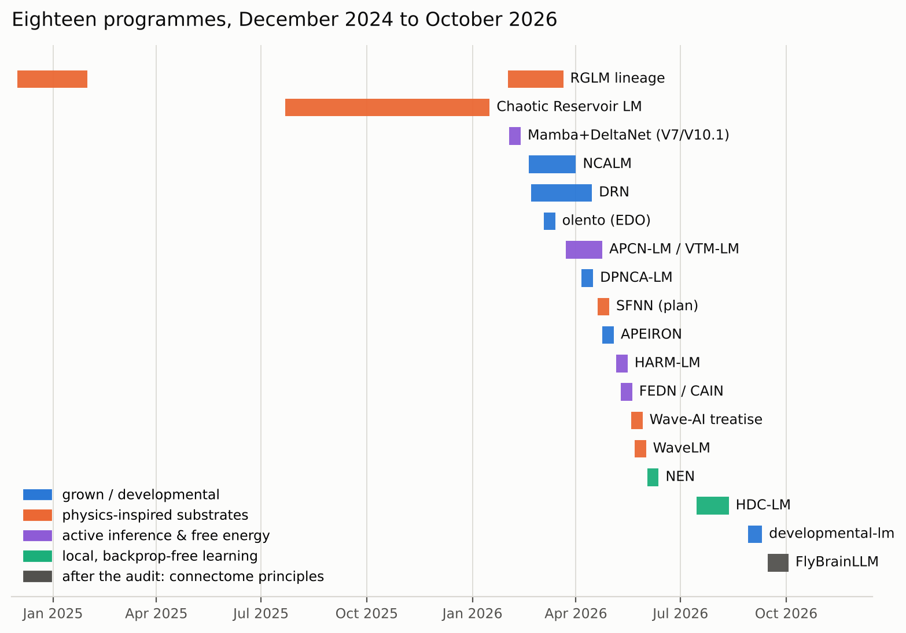
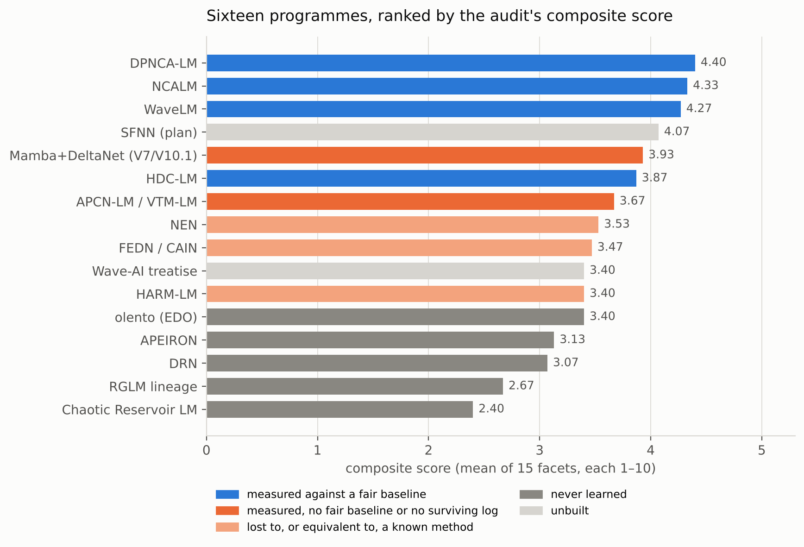
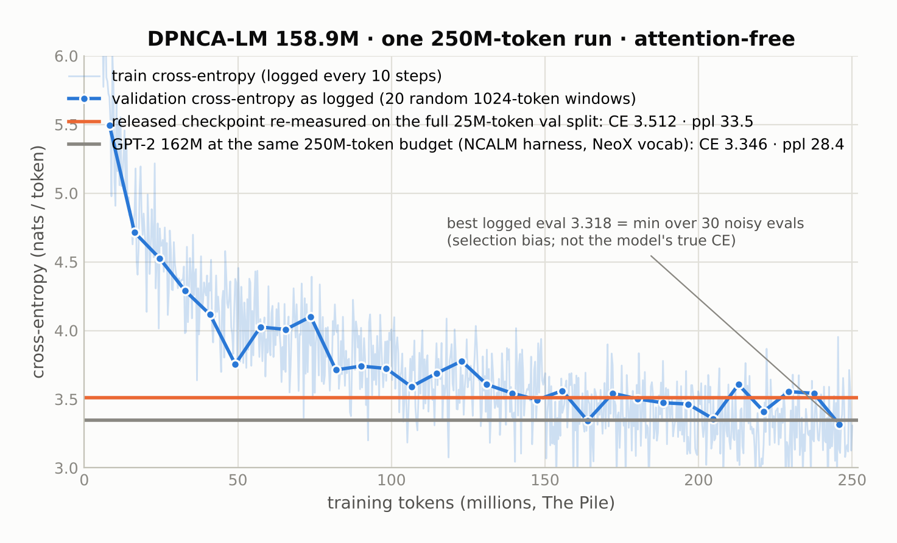
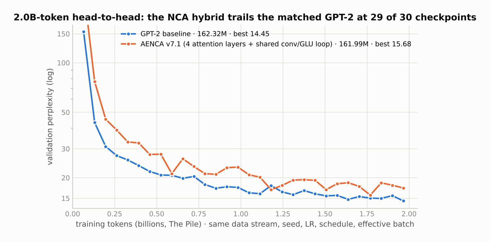
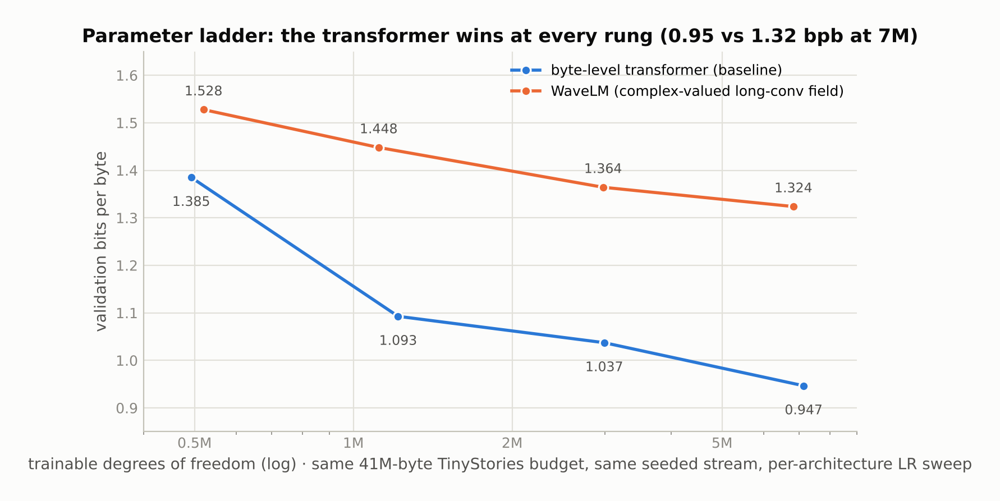
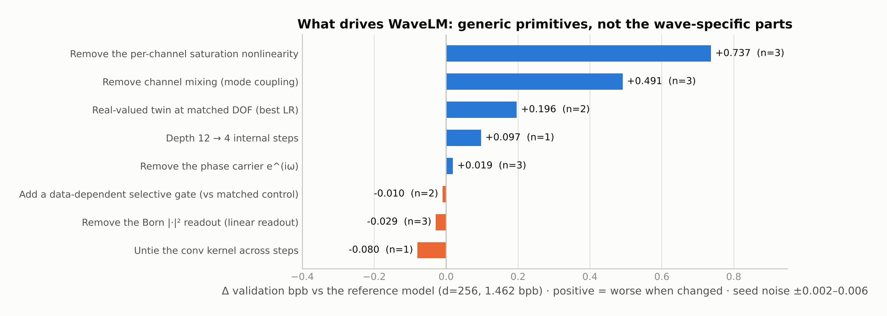
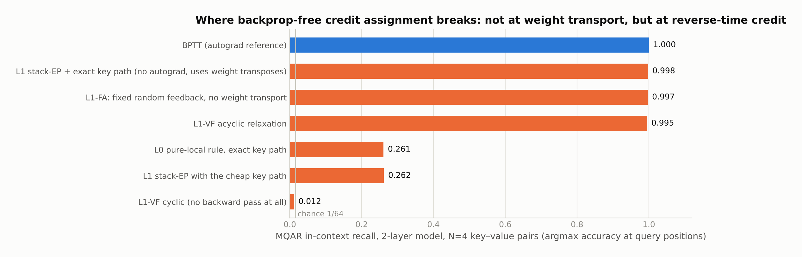
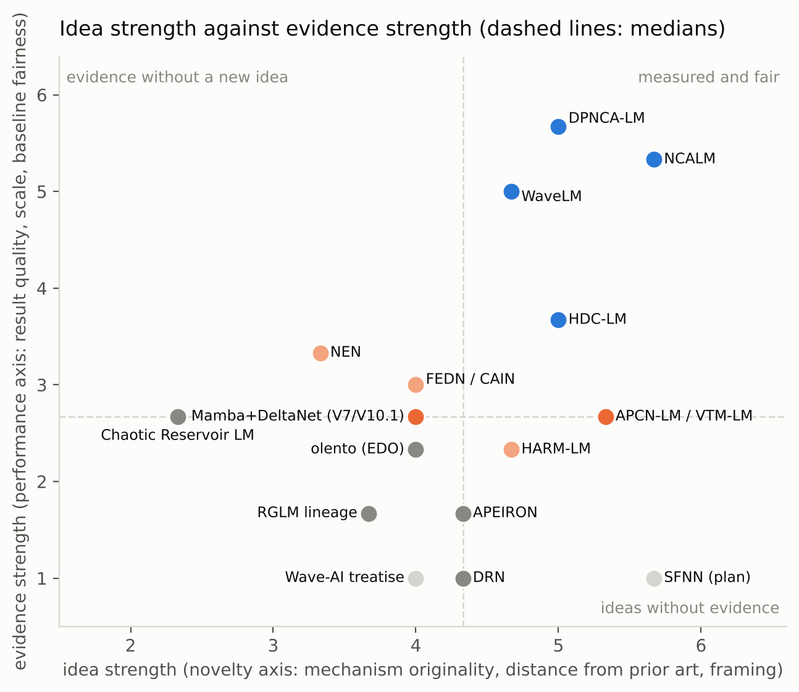
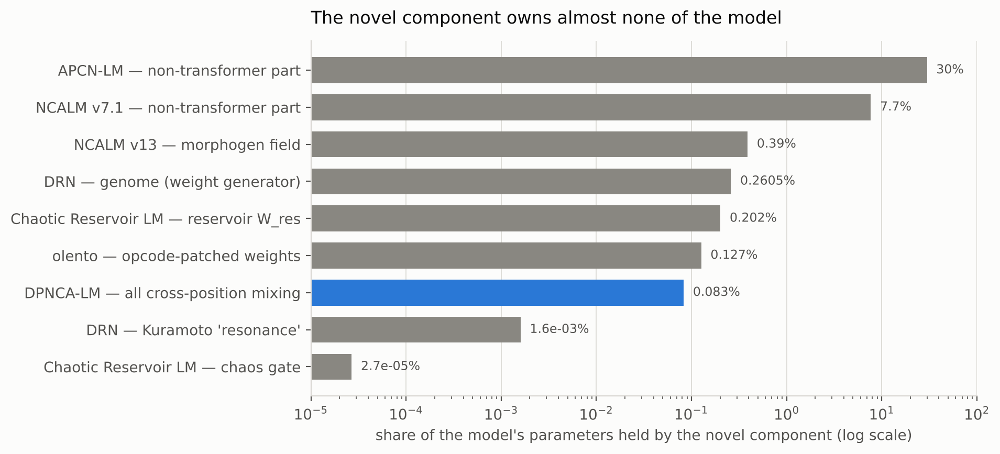
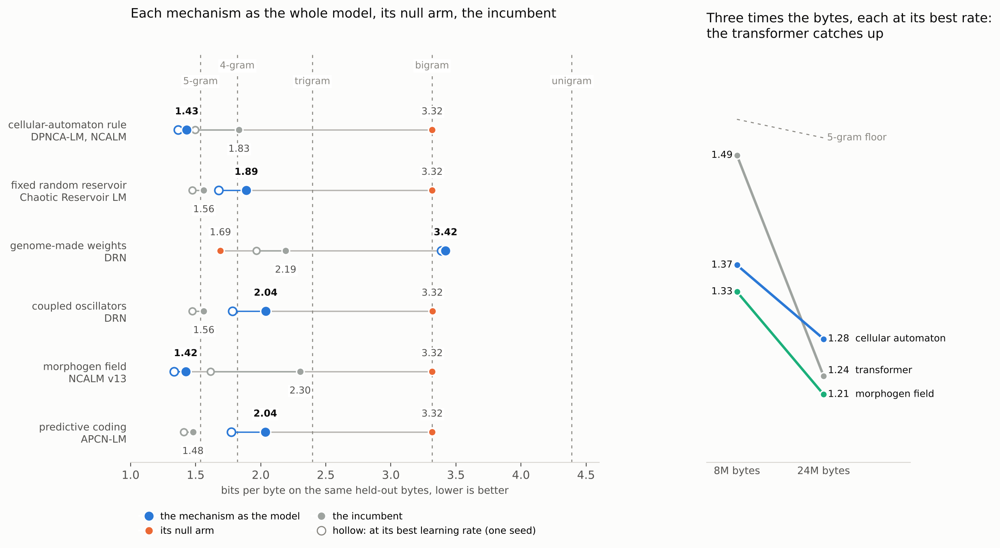

# Post-transformer research, 2024–2026: what sixteen architectures measured

Between December 2024 and August 2026 I built sixteen research programmes around one question: **can something other than attention trained by backpropagation carry a language model?** Neural cellular automata in place of attention. Complex-valued wave fields. Hyperdimensional phasor memories trained by local rules. Free-energy descent in place of layers. Weights grown from a compact genome. A self-modifying x86-64 binary whose weights are its instructions.

In August 2026 I audited all sixteen against a single evidence standard, then applied that standard to the two programmes that came after. This page is the audit with the private parts removed. It keeps the method, the grading, what survived, the ranked table, and the one finding that explains most of the rest.

**The short version.** Three programmes produced real language models measured against a fair baseline, and all three lost to a same-size transformer. A fourth produced the cleanest control in the portfolio and a sharp negative result about local learning. A fifth, written after the audit, turned six ideas into six pre-registered negative results. A sixth applied the standard from its first day, pre-registered two fly-derived mechanisms with frozen verdict rules, and falsified both. Nothing else in the portfolio survives its own evidence: the remaining programmes are unbuilt, unmeasured, measured without a baseline, or measured and refuted. No programme has a fair win over a transformer, and I no longer claim one.

The site version of this page, with interactive explainers of each surviving architecture, is at **[peterpetu.github.io/post-transformer-research](https://peterpetu.github.io/post-transformer-research/)**.



## The standard

Every statement in every programme was graded into one of three classes:

| Grade | Meaning |
|---|---|
| **CLAIMED** | it appears in prose (a design document, a README, a plan) |
| **IMPLEMENTED** | there is code that does it, and the code runs |
| **MEASURED** | there is a number in a log or a result file, and the number can be traced to the run that produced it |

Only MEASURED counts. A result whose log no longer exists is CLAIMED, whatever the document says. A mechanism that is implemented but provably cannot influence the output is IMPLEMENTED, not MEASURED, however many times it was logged.

On top of the grades, each programme was scored on five axes of three facets each, every facet on a 1–10 anchor scale: **Novelty** (mechanism originality, distance from prior art, framing), **Performance** (measured result quality, scale reached, baseline fairness), **Potential** (headroom, scalability path, blocker severity), **Academic** (publishability today, theoretical depth, reproducibility) and **Tech** (implementation maturity, efficiency and hardware angle, deployability). Two rules make the score answer to the evidence rather than to the prose: the performance facets are capped at 2 when nothing was measured, and baseline fairness scores 1 when no baseline code exists at all, because an absent baseline is worse than a weak one. Novelty and Potential are not capped, so a strong unbuilt idea still shows its shape.

The audit ran in four passes, each adversarial to the one before: every programme read branch by branch (57 branch refs across 17 repositories), with every claim graded; the four claims that would otherwise have anchored the top of the ranking attacked, and all four at least partially refuted, including two the audit itself had made; each programme's implemented architecture drawn from source, with novel components and provably inert paths marked; and every drawing attacked line by line, with 851 of 904 citations verified and every parameter count independently recomputed (two were wrong and were corrected). Where a figure could not be reproduced it was withdrawn rather than restated. Scores are calibrated judgements against stated anchors; the numbers underneath them are measurements, and every one quoted below has a file behind it in a public repository.

## What survived



| Repository | What it is | Headline measurement | Measured against |
|---|---|---|---|
| **[DPNCA-LM](https://github.com/Peterpetu/DPNCA-LM)** | an attention-free language model: a 12-layer transformer skeleton whose attention sublayer is six iterated steps of a causal neural cellular automaton; 158.9M parameters, one 19-hour run on 250M tokens of The Pile; weights released | validation cross-entropy **3.512** nats/token (perplexity 33.5), re-measured on the full validation split from the released checkpoint | a same-size GPT-2 at the same token budget: 3.346 (perplexity 28.4). The transformer wins by 15–18% |
| **[NCALM](https://github.com/Peterpetu/NCALM)** | a model-agnostic training harness, a 162M GPT-2-style baseline trained at 250M and 2.0B Pile tokens, and fifteen neural-cellular-automaton variants trained under the same protocol | baseline **14.45** PPL at 2.0B tokens; the best variant (four attention blocks plus a shared convolutional loop, 92% transformer by parameter count) 15.68, behind the baseline at 29 of 30 checkpoints; the attention-free variants 369–2,425 at 250M tokens where the baseline reaches 27.57 | matched tokens, tokenizer, seed, learning rate, schedule, batch and GPU: the fairest baseline in the portfolio |
| **[WaveLM](https://github.com/Peterpetu/WaveLM)** | a byte-level model whose state is a complex-valued field advanced by dilated causal convolution, channel mixing, a saturating nonlinearity, phase rotation and energy normalisation; 7.35M parameters | **2.298** bits per byte on The Pile; on a four-rung parameter ladder it loses to a byte transformer at every rung (1.528 / 1.448 / 1.364 / 1.324 vs 1.385 / 1.093 / 1.037 / 0.947); a 40-run ablation shows what drives it: the nonlinearity, channel mixing and depth, with the wave-specific parts adding little | a seeded, degrees-of-freedom-matched byte transformer with a per-architecture learning-rate sweep |
| **[HDC-LM](https://github.com/Peterpetu/HDC-LM)** | a gated linear-attention model over complex phasors, trained without autograd by a local rule (equilibrium propagation plus exact eligibility traces) | within **+3.3%** of its BPTT twin at matched data, seed and learning rate; on two-layer in-context recall, removing weight transport costs nothing (0.997 vs 1.000) and removing the reverse-time pass costs everything (0.012); at 162M on The Pile the rule's model reached PPL 517 against a 28.9 anchor | the identical model trained by backpropagation through time |
| **[developmental-lm](https://github.com/Peterpetu/developmental-lm)** | six pre-registered programmes on whether a compact genome can carry a useful part of what a small language model knows, plus a replication of the PNAS 2024 genomic bottleneck on a 13M model | the bottleneck at birth replicates (CE **2.86** before any training vs a null of 9.01 and a trained adult at 1.86), but only with the embedding table exempt; under environment shift, copying weights beats every compressed rebirth; where compression is load-bearing is transfer to an unseen task family | matched compute, paired seeds, common random numbers, and kill criteria written before each run |
| **[FlyBrain-LLM](https://github.com/Peterpetu/FlyBrain-LLM)** | does the fruit-fly connectome hold principles that improve sequence-memory layers? Verified circuits from MaleCNS v1.0, their principles as differentiable modules (a sparse winner-take-all address; per-address history states), hash-locked pre-registrations, frozen verdict rules | inside a trained Gated DeltaNet layer the Kenyon-cell address recalls **0.997** of 128 stored pairs where Gated DeltaNet recalls 0.79, higher at all 15 seed pairs, and the verdict is still **falsified** under the rule written before the run; an equal-memory dense key (1.000), product keys (0.999) and a learned expansion (1.000) match it; the history states' module-level gain vanished in a trained model | Gated DeltaNet at equal active rows and parameters, plus equal-compute, equal-memory, product-key and learned-expansion controls; 100 and 95 runs, 5 seeds per arm |

### DPNCA-LM: the one attention-free model within reach of a transformer



Every bit of information that moves between token positions in this model passes through 132,096 depthwise-convolution parameters, 0.083% of the model, reused 72 times per forward pass. That is enough to reach perplexity 33.5 on The Pile where a same-size transformer reaches 28.4. Causality is verified bit-exact on the trained model; the released checkpoint has no attention parameters; the receptive field is structurally bounded at 433 of the 1,024-token context. Fully attention-free variants trained under NCALM's matched protocol landed at perplexities between 369 and 2,425, so this is the only attention-free architecture I have trained that is within striking distance of a transformer, and it is undertrained by 13× against the Chinchilla ratio. Two of its three auxiliary loss terms could not produce a gradient by construction (see the cross-cutting finding below); the cross-entropy is cleanly separable from them and stands.

### NCALM: the question was sharp, and the answer was no



NCALM asked whether a weight-shared local update rule can replace attention as a drop-in, and built the infrastructure to answer it properly: one harness, one tokenizer, one seed, one schedule, one GPU, and a GPT-2-style baseline trained at two token budgets. Fifteen variants later the answer is no at this scale. The closest variant kept four attention blocks, is 92% transformer by parameter count, and still trailed at 29 of 30 checkpoints; the variants with no attention at all were between 13× and 88× worse in perplexity (the one with an archived run: 522 against 27.6). The harness and baseline are the most reusable artifact in the portfolio, and the two defects in its evaluation protocol (random validation windows, and a larger evaluation batch for the baseline) both favour the challengers, so the gap is a lower bound.

### WaveLM: a real model, and a clean measurement of what drives it



WaveLM was designed from a wave-interference metaphor and is, mechanically, a complex diagonal state-space model. It generates register-appropriate English from a cold start and reaches 2.30 bits per byte on The Pile. The ablation campaign is the result: removing the saturating nonlinearity costs 0.74 bits per byte, removing channel mixing 0.49, replacing the complex field with a real twin 0.20, removing the phase carrier 0.02, and removing the "Born rule" readout *improves* the model by 0.03. What drives it is the pointwise nonlinearity, channel mixing and depth; the wave-specific parts contribute little: the complex field 0.20 bits per byte over its real twin, the phase carrier 0.02, the readout none.



### HDC-LM: weight transport is nearly free, reverse-time credit is the wall



HDC-LM is the one programme whose control is the identical model under the standard algorithm, so every gap is the learning rule's. The rule matched BPTT to within 3.3% on a one-layer model, and the first-reported 9% gap turned out to be two fixable gradient approximations rather than the rule. The two-layer in-context-recall experiment gives the mechanism: a fully backprop-free rule reaches the ceiling (0.998 vs BPTT's 1.000) as long as it carries credit backwards in time through an explicit reverse sweep; replacing the weight transpose with fixed random feedback still reaches 0.997; removing the reverse-time pass collapses to chance (0.012). The rule matched BPTT only where it reproduced BPTT's gradient and lost everywhere it departed from it, which at 162M on The Pile meant perplexity 517 against 28.9.

### developmental-lm: six ideas, six pre-registered verdicts

Written after the audit, with the audit's lesson applied: every programme wrote its kill criteria before its first run, measured seed noise before reading any contrast, and derived its verdict mechanically from the run artifacts. The genomic bottleneck of Shuvaev, Lachi, Koulakov and Zador replicates on a 13M-parameter language model: a decoded newborn scores CE 2.86 before it has seen a token, against a null of 9.01. But the replication only holds with the vocabulary table exempt from compression (5.9× overall, 107× on the compressed layers); fully compressed, the newborn is near-null. Under environment shift, copying weights (4.08) beats every compressed rebirth (4.32–4.70) and the compression ratio has no interior optimum. Where compression is load-bearing is transfer: on a task family neither source had seen, weights copied from a free-trained source are 1.33 nats worse than a random start, and weights from the bottleneck-trained source cost 0.007. A backprop-free hyperdimensional model in the same repository reaches 2.41 nats where a trigram sits at 3.17 and a 13M transformer at 1.86.

### FlyBrain-LLM: the standard applied from day one, and both hypotheses falsified by it

The question was whether the complete fruit-fly connectome contains computational principles that improve sequence-memory layers. Two earlier phases (the wiring as a recurrent prior; an active-inference model) came back null and are reported as null. The third phase pre-registered two mechanisms with hash-locked protocols and verdict rules frozen before the runs. The sparse, winner-take-all address of the mushroom body is a real capacity mechanism: inside a trained Gated DeltaNet layer with 16-dimensional keys it recalls 0.997 of 128 stored pairs where the dense store recalls 0.79, and it was higher at every one of fifteen seed pairs. The rule asked for a gain above two seed-spreads at two of three settings; it passed at one, so the verdict is falsified, and the controls say why it is not a fly-specific win: a dense key with the same memory reaches 1.000, product keys 0.999, a learned expansion 1.000, and the expansion without sparsity gains nothing. The exact sparse step is also slower on the GPU. The second mechanism, per-address history states that had given a small replicated gain in an isolated memory, added 0.3 seed-spreads in a trained model and lost to a plain single store; falsified on every conjunct. The pre-registered language-model test was reserved for a supported mechanism, and none earned it. I reviewed the repository in October 2026: every headline number recomputes from the per-run tables, and the pre-registration hash recorded in all 195 GPU runs matches the locked files. It is also prior art, and says so: sparse addressing with a fixed random expansion is Kanerva's sparse distributed memory, and the fly circuit's version is the locality-sensitive hash of Dasgupta, Stevens and Navlakha (2017).

## The ranked table



Composite is the mean of the fifteen facets. The two programmes after the audit are listed without a score.

| # | Programme | What it is | What was measured | Verdict | Composite |
|---|---|---|---|---|---|
| 1 | **DPNCA-LM** | attention-free NCA language model, 158.9M params, 250M Pile tokens | CE 3.512 (ppl 33.5) vs a same-size GPT-2 at 3.346 (ppl 28.4); causality bit-exact; zero attention parameters | real, loses by 15–18%, undertrained, bounded receptive field. Rebuilt as the whole model (E1), the cellular-automaton rule carries a language model on its own, 0.13 bits/byte ahead of a two-layer transformer at each one's best learning rate; with three times the bytes the transformer catches up. | 4.40 |
| 2 | **NCALM** | training harness, matched GPT-2 baseline, fifteen NCA variants | baseline 14.45 PPL at 2B tokens; best variant 15.68, behind at 29/30 checkpoints; attention-free variants 369–2,425 at 250M vs 27.57 | local update rules show no headroom as attention replacements at this scale. Rebuilt as the whole model (E1 and E5), the shared rule and the v13 morphogen field each carry a language model on their own, 0.13 bits/byte ahead of a two-layer transformer and 0.28 ahead of a one-layer transformer at best rates. | 4.33 |
| 3 | **WaveLM** | complex-valued long-convolution byte model, 7.35M params | 2.298 bpb on The Pile; loses to a DOF-matched byte transformer at all four ladder rungs; ablations identify the drivers | real model; the ablation shows the nonlinearity, channel mixing and depth drive it, and the wave-specific parts add little | 4.27 |
| 4 | SFNN | a plan for language models on nonlinear optical-fiber propagation with trainable phase modulators | nothing; zero code | the strongest unbuilt idea in the portfolio; contains a dispersion sign error to fix before any simulation | 4.07 |
| 5 | Mamba+DeltaNet (V7/V10.1) | small state-space hybrids with predictive-coding and active-inference objectives, 152 runs | V7: 8.03 PPL on TinyStories, the best honest number; a later headline of 5.8 was a metric bug (plain CE of that checkpoint: 8.69); the active-inference terms were 0.33–0.76% of the loss | the backbone did the work; without a same-tokenizer plain baseline, the numbers cannot show whether the added objectives helped | 3.93 |
| 6 | **HDC-LM** | backprop-free credit assignment for a phasor linear-attention LM | +3.3% vs the BPTT twin; MQAR double dissociation; 162M Pile PPL 517 vs 28.9 | weight transport is nearly free; reverse-time credit is the wall | 3.87 |
| 7 | APCN-LM / VTM-LM / PROTHEUS | predictive-coding cells fused with transformer blocks; a genome-expanded active-inference agent trained by evolutionary search | APCN-LM documented at PPL 28.6 on 250M Pile tokens, but the run directory was not retained; own collapse analysis: KL ≈ 0.004, cross-entropy carrying ≥ 93% of the gradient | the best numbers have no surviving log and no control; the predictive-coding branch collapsed to a near-no-op and that collapse was measured carefully. Rebuilt as the whole model (E6), two-level predictive coding carries a language model on its own, 0.36 bits/byte behind a trained GRU at best rates. | 3.67 |
| 8 | NEN | a NumPy hierarchical predictive-coding classifier | MNIST 95.31%, Fashion-MNIST 84.6%; the inference-time relaxation contributes nothing measurable; the update is numerically identical to backprop (cosine 1.000000) | clean engineering of a known algorithm | 3.53 |
| 9 | FEDN / CAIN | byte models in which K transformer layers are replaced by K steps of Langevin descent on a learned free energy | every version lost to its matched byte transformer (v3.1: 2.502 vs 1.495 NLL); 1 vs 32 descent steps differ by 0.004 nats | the descent steps change the loss by 0.004 nats and are switched off at inference, leaving an MLP over byte and position embeddings | 3.47 |
| 10 | olento (EDO) | a freestanding x86-64 binary whose ternary weights are live ADD/SUB/NOP instructions, patched in place | live code self-modification verified to the opcode byte; the language model around it never beat a unigram predictor | the most original systems artifact in the portfolio; the self-modifying path covers at most 0.13% of the weights, so learning did not run through it | 3.40 |
| 10 | HARM-LM | a gradient-free renormalising generative model with hyperdimensional context and a ridge readout | best 4.64 bits per byte on TinyStories against a 4.45 byte-frequency floor; later runs degraded with more data | three gradient-free implementations, all above the floor | 3.40 |
| 10 | Wave-AI treatise | a ~10,000-word position paper on wave-native computation | nothing; zero code; no reference section | the proposed architecture is original and untested; it seeded HDC-LM two months later | 3.40 |
| 13 | APEIRON | a 14.1M byte model on a sparse random graph with per-unit time constants and synaptogenesis | all runs at or above the 8.0 bits-per-byte uniform floor; 24 optimizer steps in total | a message-scaling bug left the substrate contributing 0.009% of the logits, so its own question was never put to a test | 3.13 |
| 14 | DRN | a 160M model whose weights are emitted by a 418K-parameter hypernetwork in a depth-recurrent loop | cross-entropy ln(50257) at every step: dead at initialisation | built and run; training never started because the generator was zero-initialised; the hypernetwork module is clean. Rebuilt as the whole model (E3 and E4): the genome does not carry a language model and finishes worse than its null arm; the coupled oscillators do, 0.31 bits/byte behind a trained GRU at best rates. | 3.07 |
| 15 | RGLM lineage | three generations of "renormalisation-group" hierarchical language models, 49M–163M params | unigram-level perplexity (CE 6.34 nats); no baseline | three generations; in each, the hierarchy never reached the gradient (flagged off, detached, or cancelled by the softmax) | 2.67 |
| 16 | Chaotic Reservoir LM | a 78M model with a frozen sparse reservoir, trained 27 days on 8.3B tokens | final CE 5.25 (ppl 191); the sequence axis is flattened into the batch, so the trained model is a rank-512 bigram table, about 0.26 nats worse than a counted bigram | as built, the reservoir added nothing beyond a rank-512 bigram table. Rebuilt as the whole model (E2), a fixed random reservoir that recurs carries a language model on its own, 0.20 bits/byte behind a trained GRU at best rates. | 2.40 |
| — | **developmental-lm** | six pre-registered compact-genome programmes and a genomic-bottleneck replication | see above: birth 2.86 vs null 9.01; copy 4.08 beats every rebirth; transfer +0.007 vs +1.33 | every mechanism lost to copying at matched compute, each by a criterion written before the run | not scored |
| — | **FlyBrain-LLM** | connectome-derived principles for sequence-memory layers, hash-locked pre-registrations, frozen verdict rules | sparse address in a trained Gated DeltaNet layer: 0.997 vs 0.79 recall at 128 pairs, higher at 15 of 15 seed pairs, verdict falsified under the frozen rule; equal-memory dense 1.000, product keys 0.999, learned expansion 1.000; history states +0.016 / +0.006, falsified | two mechanisms, both falsified by rules written before the runs; the standard applied from day one | not scored |

## Four findings that cut across the portfolio

### 1. In sixteen instances the novel mechanism never reached a gradient

This is the finding that explains most of the ranking. Again and again the idea was implemented correctly, wired in and logged, and then something structural prevented it from ever influencing learning: a detached tensor, a scalar broadcast that the softmax cancels, a zero-initialised generator, a flag left off in the competitive configuration, an initialisation that sets every error term to its minimum. In no case was it noticed at the time. The mechanisms are usually mathematically right where they are written; what failed, every time, was checking that the new part was load-bearing before scaling it up.

| Programme | Mechanism | How it died |
|---|---|---|
| RGLM | logit adjustment from the hierarchy | a scalar broadcast across the vocabulary axis, which the softmax cancels |
| RGLM | the second-level hierarchy | computed and normalised, never read by anything downstream |
| RGLM | inter-level messages | detached from the graph, so they enter as constants |
| DRN | Kuramoto "resonance" | detached and converted to a scalar; gradient exactly zero |
| DPNCA-LM | the two routing regularisers | computed from routing weights detached before accumulation |
| DPNCA-LM | running statistics over NCA steps 3–5 | reset after step 2 and never consumed; half the statistics computation per layer is dead |
| NEN | free-energy relaxation | the initialisation sets every prediction error to its minimum, so the thirty-step relaxation has nothing to do after its first step |
| FEDN | free-energy descent | 1 and 32 descent steps differ by 0.004 nats; the descent is switched off at inference |
| FEDN | the criticality term | its running statistic is only ever written into a buffer under no-grad, which makes the term an additive constant |
| Mamba+DeltaNet | expected free energy | 0.33–0.76% of the loss; the phases that compute it are 0.2% of the compute and their gradients are detached |
| HARM-LM | expected free energy | about 10⁻⁵ nats of a loss near 8 |
| HARM-LM | the product-of-experts fusion gate, the one novel joint | an attribute guard that never matches, so the gate stays at its warm-start value in every run while the log reports it as refined |
| HARM-LM | the quantile head's state | updated on every training byte, never read, absent from the checkpoint |
| NCALM v14 | the lag coupling between NCA steps | the model's own Jacobian: self-weight 0.997, lag ≥ 3 exactly zero |
| APEIRON | the entire graph substrate | an unnormalised message product leaves 89.3% of the parameters reaching 0.009% of the logits; the output at zero hidden state is a constant vector |
| APCN-LM / PROTHEUS | the expected-free-energy step | behind a flag that the competitive configuration sets to false |

Everything in the right-hand column is a few minutes of checking at the smallest scale that runs: switch the component off, train both arms, compare. I had the harnesses to do it and never ran the null arm until the audit.

### 2. The novel component owns almost none of the model



Where the novel mechanism did reach a gradient, it was usually a sliver of the model it sat in. DPNCA-LM is the honest version of this: 0.083% of the parameters do all the cross-position work, by design, and the README says so. In the others, the share is the reason the headline perplexity looks respectable: the transformer around the mechanism did the work. The section below runs the experiment this chart asks for.

### 3. Backprop-free is a spectrum, and every point on it lost

The portfolio covers the whole range. NEN is a hand-derived local rule with no autograd anywhere, and its update has cosine 1.000000 to backprop. HDC-LM's rule is validated by exact identity to BPTT where it works and loses where it departs. HARM-LM's first three versions are gradient-free NumPy and all sit above a 256-entry byte-frequency table. Two programmes that described themselves as backprop-free were, in their later versions, trained by AdamW. And the two points nearest true locality performed worst: a pure-local rule reaches 0.26 recall on two-layer in-context recall and a transport-free space-time relaxation reaches chance, 0.012, against BPTT's 1.000. No backprop-free variant beat a tuned gradient baseline, and the closer a rule came to being local the worse it did.

### 4. Free energy is 83–99.7% cross-entropy

Measured independently in four programmes: the active-inference, predictive-coding and expected-free-energy objectives were between 0.3% and 17% of the loss by magnitude, and in the one case where the extra term was large enough to matter it was antagonistic to the cross-entropy gradient and had to be clamped. Every perplexity reported under a free-energy objective is, to within those margins, a perplexity trained by cross-entropy.

## The null arm, run

The chart above was measured on the programmes as I built them. The obvious reply is: make the mechanism the model and see what it carries. So, for six of the mechanisms, I did. Each is rebuilt as the load-bearing part of a byte-level language model and trained beside its null arm (the mechanism switched off, everything else identical) and beside the incumbent it was meant to replace, at the same byte budget, scored on the same 262,144 held-out TinyStories bytes. Two seeds each. The code, every run record and the rendered tables are in [`experiments/loadbearing/`](experiments/loadbearing/).

Two calibrations sit beside every number. The first is the null arm, which by construction can do no better than a bigram model, and in all six experiments lands within 0.01 bits per byte of the bigram floor. The second is a ladder of n-gram floors on the same bytes, counted from as many training bytes as the models see: unigram 4.39, bigram 3.32, trigram 2.40, 4-gram 1.82, 5-gram 1.54 bits per byte. A model at the bigram floor has learned nothing about context; a model under the 5-gram floor has learned more than five bytes of memorised statistics can give.



| mechanism as the whole model | share of trainable parameters it holds now (and held then) | mechanism | null arm | incumbent | both at their best learning rate |
|---|---|---|---|---|---|
| E1. a shared cellular-automaton rule, iterated six times, nothing else (DPNCA-LM, NCALM) | 67% (0.083%) | **1.432** | 3.317 (no cross-position perception) | 1.834 two-layer transformer; 2.303 one-layer | 1.37 / 1.49 |
| E2. a fixed random reservoir as the only sequence operator (Chaotic Reservoir LM) | the reservoir is 25% of all parameters and trains none of them (0.2%) | **1.889** at ρ 0.9; 1.727 at ρ 2.1 | 3.317 (no recurrence) | 1.563 trained GRU, same state size | 1.68 / 1.47 |
| E3. every weight emitted by a 13K-parameter genome (DRN) | 100% (0.26%) | **3.421** | 1.690 (the same model, weights trained directly) | 2.192 direct weights at the genome's parameter count | 3.39 / 1.97 |
| E4. coupled oscillators as the recurrence (DRN) | 20%, and the coupling is the only interaction (0.0016%) | **2.038** | 3.318 (no memory) | 1.563 trained GRU | 1.78 / 1.47 |
| E5. a morphogen field as the only thing that crosses positions (NCALM v13) | 80% (0.39%) | **1.424** | 3.318 (no diffusion) | 2.303 one-layer transformer | 1.33 / 1.61 |
| E6. two-level predictive coding as the whole model (APCN-LM) | 22%; the rest is the readout (about 30%) | **2.035** with three inference steps; 2.021 with one | 3.318 (no memory) | 1.479 trained GRU | 1.77 / 1.41 |

Two seeds agree to within 0.05 bits per byte for every arm except the two whose quality rests on a random draw (the frozen genome, 0.22 apart; the fixed random coupling, 0.05) and the wider genome noted below; the learning rate matters far more. Doubling it from the default improved every mechanism and every incumbent, so each was swept from 0.001 to 0.016 (to 0.032 where the best was still at the top; one seed). The transformers gain the most (the one-layer 2.31 to 1.61, the two-layer 1.86 to 1.49), the two local models and the GRUs the least (0.06 to 0.09), and the order of the mechanisms does not change at any rate. The last column and the comparisons with the incumbents below use each model's best rate; the comparisons with the null arms do not need one, because a null arm sitting on the bigram floor has nothing left to gain.

What the six say:

* **All six learn, and five carry a language model when they have to.** Every null arm sits on the bigram floor, and five of the six mechanisms sit 1.3 to 1.9 bits per byte under it. None of them was inert as a mechanism. They were inert in the programmes because of how they were wired in, which is the audit's finding restated from the other side.
* **Two are good at this scale, and they are the same model.** The iterated cellular-automaton rule (E1) and the diffusion field with a per-position nonlinearity (E5) reach 1.43 and 1.42 at the default rate and 1.37 and 1.33 at their best: under the 5-gram floor, and 0.13 to 0.16 under the two-layer transformer at its best (1.49) with fewer parameters. They are nearly the same model, a local, weight-shared, iterated update whose only cross-position operator is a short causal kernel (depthwise convolutions in one, a per-channel exponential decay in the other), and the ablations agree: iteration is load-bearing (the rule applied once, 1.61), the nonlinearity is load-bearing (diffusion alone, 2.83), and weight sharing costs 0.17 against the same rule unshared with four times the parameters (1.27). Then the budget check. At three times the bytes, each at its best rate, the transformer gains 0.26 and the two local models 0.09 and 0.12, and the three finish within 0.07 of one another (1.24, 1.28, 1.21). The locality prior pays off early; attention catches up with data, which is the usual order of things and the reason the "two are good" should be read as "two are good at eight million bytes".
* **Three are real but weak recurrences.** A fixed random reservoir that recurs (1.89, or 1.73 in the chaotic regime the original used), trained Kuramoto coupling (2.04) and two-level predictive coding (2.04) all land between the trigram and 4-gram floors at the default rate and under the 4-gram floor (1.83) at their best (1.68, 1.78, 1.77), each 0.2 to 0.4 behind a trained GRU of the same state size at its best (1.47, 1.47, 1.41). In the original Chaotic Reservoir LM the sequence axis had been flattened into the batch, so the reservoir never recurred and the model was a bigram table; this is what the same idea does when it recurs. In the predictive-coding model three inference iterations per byte are no better than one (2.035 against 2.021): the first error-correction step is the mechanism and iterating it is decoration, the FEDN and NEN finding reproduced in a model where predictive coding is the whole thing. Two arms that switch the mechanism off without removing memory do worse than no memory at all: oscillators with the coupling off only integrate (3.96) and predictive-coding states with the gains pinned at zero never move (4.39). Neither can represent a bigram, which is why neither is the null arm.
* **One cannot express the weights it is asked for.** DRN's generator, a small network over Gray-coded index pairs, reaches 3.42 trained end to end (3.39 at its best rate): it learns, since the same generator frozen with a trained readout gives 3.86, but it never leaves the bigram floor, while the same phenotype with its 66K weights trained directly reaches 1.69 and a directly trained phenotype with the genome's own parameter count reaches 2.19 (1.97 at its best rate). A generator with three times the parameters trained on one seed (3.40) and sat at the unigram floor on the other, at the default rate and at a quarter of it, so the limit is partly optimisation and mostly the function class: a smooth function of index bits is a poor basis for the weights a byte model needs. GNOMON in developmental-lm reached the same conclusion with evolution instead of gradients: its evolved genome at 5.24 nats against a free-weight twin of the same architecture at 3.02.

The parameter-share chart has its answer. Moved to the centre of the model, five of the six mechanisms are load-bearing, and the order among them is set by what they are as sequence operators: a short causal kernel iterated with shared weights is a strong prior for bytes at this scale, a recurrence through fixed, oscillating or error-corrected state is a weaker one, and a generator over index bits is not a prior for these weights at all. What none of this changes is the comparison that mattered in the audit. At the scale where the original programmes made their claims, every one of them had a transformer or a GRU doing the work, and the budget check is the first line of why: the incumbent gains more from more data than the mechanisms do. These runs are six to twenty-four million bytes on two CPU cores; they say what each mechanism carries, not where it would end up.

## The one habit

I diagnosed most of these failures myself, in writing, at the time. "Mamba is strictly better on every axis DPNCA claims as an advantage." "A vanilla byte-level transformer is stronger than WaveLM." "Still not learning properly." "The model has plateaued." I was rarely fooled by a result. What I did instead of ablating was start the next programme.

The habit that would have changed everything: **before scaling any new mechanism, ablate it at the smallest scale that runs.** Almost every row of the table above would have been caught in minutes by a single run with the novel component switched off. The two programmes written since the audit are built around that habit. Between them they tested eight mechanisms against criteria written before the runs; all eight failed them, and the findings are ones I can defend.

## What I claim, and what I don't

I claim: an attention-free NCA language model that trains to within 15–18% of a transformer at 160M parameters; a matched harness in which fifteen attention replacements were measured and lost; a complex-valued byte model with a clean ablation; a backprop-free learning rule whose failure mode is located precisely; a replicated genomic bottleneck with its catch stated; a pre-registered test of the fly's sparse addressing that its own rule falsified, with the controls that explain the win; and the cross-cutting finding above, which I think generalises beyond my own work.

I do not claim: any win over a transformer; any backprop-free advantage; any "emergent" property; and any result whose log no longer exists, including two of my own best numbers.

## Reference floors

Several of the programmes reported numbers with no floor beside them. These were computed during the audit from the repositories' own data (train on 200 MB, held-out evaluation, interpolated back-off) and are the floors the numbers above should be read against.

| Corpus | Uniform | Unigram | Bigram | Trigram |
|---|---|---|---|---|
| TinyStories, bytes | 8.000 bpb | 4.377 | 3.325 | 2.435 |
| The Pile, bytes | 8.000 bpb | 5.024 | 4.023 | 3.296 |
| GPT-2 tokens (WikiText proxy) | 10.825 nats | 7.505 | ≈4.99 (at 8.3B tokens) | 5.646 (at 200 MB) |

## Repositories

| Repository | Contents |
|---|---|
| [DPNCA-LM](https://github.com/Peterpetu/DPNCA-LM) | model, training code, complete training log, released fp16 weights, verification scripts, 107 tests |
| [NCALM](https://github.com/Peterpetu/NCALM) | harness, baseline, variants, per-run logs and metrics for every run cited, the comparative protocol |
| [WaveLM](https://github.com/Peterpetu/WaveLM) | model, baseline harness, ladder and ablation results, 43 tests |
| [HDC-LM](https://github.com/Peterpetu/HDC-LM) | model, learning rule, the S3–S8 experiments with their outputs, 95 tests including the backprop-free audit |
| [developmental-lm](https://github.com/Peterpetu/developmental-lm) | six programmes with protocols, evidence ledgers, mechanically rendered registers and run artifacts |
| [FlyBrain-LLM](https://github.com/Peterpetu/FlyBrain-LLM) | three phases, hash-locked pre-registrations, per-run tables for the GPU grids, verdict scripts, 124 tests |
| this repository | the write-up, `data/scores.csv` (the sixteen × fifteen facet matrix), `data/projects.json`, the figures and the script that renders them, and the site under `docs/` |

The twelve audited programmes without a repository above are archived privately. Their code is withheld because nothing in it meets the standard above, and publishing it would invite claims I cannot back.

## License and citation

The code and any released weights are licensed under the Apache License 2.0 (`LICENSE`); the documentation, figures and data under CC BY 4.0. Both require attribution: a copy or derivative of the code keeps the `NOTICE` file, and any reuse of the text, figures or data credits the author and links to the source.

If you use this work, build on it, or report results obtained with it, cite it:

> Lahtinen, P. (2026). *Post-transformer research, 2024 to 2026: what sixteen architectures measured.* https://github.com/Peterpetu/post-transformer-research

```bibtex
@misc{lahtinen2026post,
  author = {Lahtinen, Peter},
  title  = {Post-transformer research, 2024 to 2026: what sixteen architectures measured},
  year   = {2026},
  url    = {https://github.com/Peterpetu/post-transformer-research}
}
```

`CITATION.cff` carries the same reference for GitHub's "Cite this repository" button and for reference managers.
